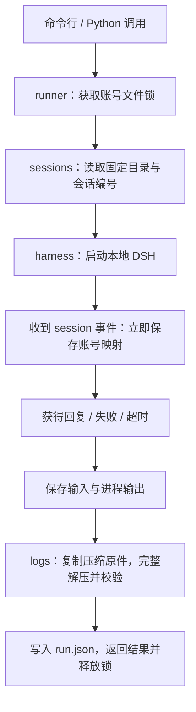

# Python Social Agent

使用本机已安装的 DeepSeek Harness（DSH）发送消息、续接账号会话，并导出可供分析的原始事件日志。

第一版的入口是一轮对话。平台读取和动作执行通过 `PlatformPort` 预留，`FakePlatform` 可独立用于联调。

## 快速开始

要求：Python 3.11+、支持 `--profile headless`、`--json` 和会话日志持久化的 DSH，以及 DeepSeek API Key。

下载项目后，在项目文件夹打开终端。Windows PowerShell：

```powershell
python -m venv .venv
.\.venv\Scripts\python.exe -m pip install -e .
Copy-Item .env.example .env
```

macOS / Linux：

```bash
python3 -m venv .venv
./.venv/bin/python -m pip install -e .
cp .env.example .env
```

复制 `.env` 只需在首次配置时执行，已有密钥文件时直接保留。打开 `.env`，在等号后填入密钥并保存：

```dotenv
DEEPSEEK_API_KEY=在这里填写你的密钥
```

然后检查运行条件：

```powershell
.\.venv\Scripts\python.exe -m social_agent doctor
```

`doctor` 只检查启动入口和密钥是否存在，不调用模型、不显示密钥。Windows 自动查找桌面安装目录和开始菜单快捷方式，macOS 检查系统与用户的 Applications 目录；其他布局见下方配置说明。

以下示例使用 PowerShell；在 macOS / Linux 上将 `.\.venv\Scripts\python.exe` 替换为 `./.venv/bin/python`，文件路径使用 `/`。

同一个账号连续运行两次：

```powershell
.\.venv\Scripts\python.exe -m social_agent run --account account-001 --prompt '请记住实验代号：星河7821。只回复已记住，不要调用工具。'
.\.venv\Scripts\python.exe -m social_agent run --account account-001 --prompt '刚才的实验代号是什么？只回复代号，不要调用工具。'
```

两次命令是两个独立的 Python 进程，但会使用相同的 DSH 会话。命令输出包含回复、会话编号、导出目录和运行状态。模型调用会使用 API 配额。

长提示词可以放在 UTF-8 文件中：

```powershell
.\.venv\Scripts\python.exe -m social_agent run --account account-001 --prompt-file .\prompt.txt --json
```

退出码为 `0` 表示模型回合和日志导出均成功，`1` 表示失败。`--json` 提供机器可读的运行结果。

## 配置

复制配置示例，然后修改需要的项：

```powershell
Copy-Item agent.example.toml agent.local.toml
.\.venv\Scripts\python.exe -m social_agent --config agent.local.toml doctor
.\.venv\Scripts\python.exe -m social_agent --config agent.local.toml run --account account-001 --prompt '你好，请只回复收到。'
```

`--config` 放在子命令前。配置文件中的相对路径以该文件所在目录为基准；省略配置文件时，以运行命令的目录为基准。建议始终从项目目录启动，或固定使用同一份配置文件。

| TOML 配置项 | 环境变量 | 默认值 |
|---|---|---|
| `dsh_executable` | `AGENT_DSH_EXECUTABLE` | 自动寻找桌面版可执行文件 |
| `dsh_command` | 无，使用 TOML 数组 | 空；使用桌面版，Unix 找不到桌面版时尝试 PATH 中的 `dsh` |
| `dsh_home` | `DSH_HOME` | 用户目录下的 `.dsh` |
| `data_dir` | `AGENT_DATA_DIR` | `.agent-data` |
| `output_dir` | `AGENT_OUTPUT_DIR` | `outputs` |
| `model` | `AGENT_MODEL` | `deepseek-flash` |
| `timeout_seconds` | `AGENT_TIMEOUT_SECONDS` | `300` |

优先级为环境变量、TOML、默认值。API Key 优先使用 `DEEPSEEK_API_KEY` 环境变量，其次读取配置文件所在目录的 `.env`；未指定配置文件时读取运行目录的 `.env`。密钥只传给 DSH 子进程，不修改当前 Python 进程环境。

`.env` 已被 Git 忽略，仓库保留空白 `.env.example` 供复制。解析支持单行值、成对单引号或双引号和普通注释，不执行变量展开。若当前终端已经设置了空的 `DEEPSEEK_API_KEY` 环境变量，可执行 `Remove-Item Env:DEEPSEEK_API_KEY` 后改用文件中的值。

模型端点沿用 DSH 的 `DEEPSEEK_BASE_URL` 约定，需为其原生适配器支持的 Messages 兼容端点。每次调用用临时配置覆盖模型选择并关闭桌面端凭据来源，保留桌面端已有配置文件。

### 不同电脑与 DSH 安装方式

项目不保存作者电脑的安装路径。自动查找失败时，复制 `agent.example.toml` 为 `agent.local.toml`，按本机情况选择一种启动方式：

```toml
[agent]
# 桌面版：填写本机可执行文件的绝对路径。
# Windows 示例：C:/path/to/DeepSeek Harness/DeepSeek Harness.exe
# macOS 示例：/Applications/DeepSeek Harness.app/Contents/MacOS/DeepSeek Harness
# Linux 示例：/opt/deepseek-harness/deepseek-harness
dsh_executable = '/absolute/path/to/desktop-executable'
```

也可以使用支持相同参数的独立 CLI：

```toml
[agent]
# macOS / Linux，dsh 已在 PATH 中。
dsh_command = ['dsh']

# 或使用 Node 和 CLI 脚本路径；脚本及附加路径参数使用绝对路径。
# dsh_command = ['node', '/absolute/path/to/cli.js']
```

`dsh_command` 非空时优先使用它。参数数组按原样传给子进程，不经过 shell 拆分。
Windows 的 `.cmd` / `.bat` 启动器需要改用 `node.exe` 与对应脚本路径，或使用桌面版。
桌面版要求安装资源中存在 `app.asar`；macOS 使用 `Contents/Resources` 布局，其余桌面布局使用可执行文件旁的 `resources`。

Windows 本机已完成真实 DSH 的两轮调用与日志验证；macOS / Linux 的桌面安装和真实模型调用仍需在对应机器验收。仓库的 GitHub Actions 在三个操作系统的 Python 3.11、3.13 上运行离线测试，不需要密钥或 DSH 安装。

换电脑部署时重新安装依赖、配置本机 DSH 和 `.env`，使用新的实验账号。已有会话会核对原工作目录：本项目不会把旧电脑的会话编号自动续接到新路径。需要迁移历史时，同时保存 `.agent-data`、DSH 原始会话与导出日志，并单独验证 DSH 对原路径的要求。

### 项目文件夹

```text
social_agent/          主代码，从 runner.py 开始阅读
tests/                 自动测试
.github/workflows/     多系统测试配置
README.md              使用说明
pyproject.toml         安装和依赖声明
agent.example.toml     配置示例
.env.example           空白密钥模板
```

运行时会生成 `.venv`（Python 环境）、`.agent-data`（账号与会话）、`outputs`（分析产物），
这些目录和本机 `.env` 均被 Git 忽略。`__pycache__` 和 `*.egg-info` 是可再生成的缓存与安装元数据。
交付代码时提交上述源码与模板；实验数据在本机单独保管。

## 一次运行如何流转



建议按以下顺序阅读代码：

| 模块 | 主要阅读内容 |
|---|---|
| `social_agent/runner.py` | `AgentRunner.run()`、`_run_locked()`：完整业务流程 |
| `social_agent/config.py` | `AppConfig`、`load_config()`：全部可配置项 |
| `social_agent/harness.py` | `HarnessClient.send()`：进程调用和返回值 |
| `social_agent/sessions.py` | `SessionStore`：账号锁、固定目录和原子保存 |
| `social_agent/logs.py` | `LogExporter.export()`：定位与无损导出 |
| `social_agent/platform.py` | 平台组需要实现的接口和虚拟示例 |
| `social_agent/__main__.py` | 参数解析、终端展示和退出码 |

业务流程为同步执行。`harness.py` 内部的读取线程只用于同时处理 stdin、stdout、stderr，防止子进程管道塞满。

## 从 Python 调用

```python
from pathlib import Path
from social_agent import AgentRunner, load_config

config = load_config(Path("agent.local.toml"))
runner = AgentRunner(config)

result = runner.run("account-001", "请只回复：收到。")
print(result.status)
print(result.reply)
print(result.session_id)
print(result.output_dir)
```

`RunResult.status` 为 `completed`、`failed` 或 `timed_out`。账号已被另一次运行占用时抛出 `AccountBusyError`，由调用方决定何时再次尝试。

每个账号的映射保存在 `.agent-data/accounts/<账号哈希>/session.json`，工作目录为同层的 `workspace`。账号编号原样保存在映射与归档中，哈希仅用于文件夹名称。持续会话期间保留这些目录，DSH 会检查原工作目录。

会话失效、账号映射损坏、目录不一致时会明确失败。研究者要创建独立对话时使用新的账号编号。文件锁覆盖整个调用和导出过程；它协调本项目启动的进程。

## 导出文件与分析含义

每轮运行生成独立目录：

```text
outputs/<账号哈希>/<UTC时间>-<运行UUID>/
  prompt.txt                  本次输入
  reply.txt                   本次最终回复
  stdout.jsonl                DSH 的运行控制事件
  stderr.txt                  进程诊断信息
  session.v<N>.jsonl.zstd      原始会话压缩文件的副本
  session.jsonl               完整解压、逐行校验后的事件日志
  run.json                    运行状态、归属、时间、源路径、SHA-256 等
```

- `session.jsonl` 是会话累计历史快照。连续两轮的导出会包含重叠历史，合并分析时按会话编号与原事件序号去重；本轮输入另存在 `prompt.txt`。
- `stdout.jsonl` 是 DSH 的运行投影，部分内容会被截短或省略；分析时使用原始压缩文件和 `session.jsonl`。
- 压缩原件按字节复制，可用 `run.json` 中的 SHA-256 复核。JSONL 不筛选事件，不改字段，不重新序列化。
- DSH 会话日志记录其公开持久化的事件，例如消息、工具调用、执行结果和上下文压缩；它不等同于模型完整的内部认知。
- 模型失败、超时后仍尝试导出已提交的事件。日志有损坏时保留压缩原件和 `session.jsonl.partial`，在 `run.json` 中记录原因；`.partial` 不视为完整日志。
- 已知 API Key 在本项目保存的进程输出和错误中会被遮盖。DSH 原始日志为无损归档，保持其自身内容。
- `run.json` 使用带时区的 UTC 时间；目录名中的 `Z` 也表示 UTC。

单独导出已有会话不需要 API Key：

```powershell
.\.venv\Scripts\python.exe -m social_agent export --session-id 'session-实际UUID' --cwd '该会话原工作目录的绝对路径' --output-dir '.\outputs\manual-export-001'
```

导出时按会话编号精确寻找目录，校验日志头的会话编号和工作目录，并按数字选择最高的规范格式版本。每次使用新的输出目录。

## 与平台组对接

平台组实现 `PlatformPort` 的两个方法，复用接口类型：

```python
from social_agent.platform import Action, FakePlatform, PlatformPort

platform: PlatformPort = FakePlatform()
observation = platform.observe("account-001")
action = Action("comment", target_id=observation.posts[0].post_id, text="模拟评论。")
outcome = platform.execute("account-001", action)
assert outcome.simulated
```

`Observation` 包含账号编号与帖子；`Action` 包含动作类型、目标帖子编号和可选正文；`ActionResult` 包含执行成功与否、模拟标记和说明。预留 `browse`、`like`、`comment`、`post`、`skip` 五类动作。

接入真实平台时实现相同方法，并把 `simulated` 设为 `False`。第一版 `AgentRunner` 只调用 DSH；后续在其上扩展回合流程，加入“获取信息 → agent 输出结构化决策 → Python 校验 → 执行动作 → 将真实执行结果反馈给 agent”，同时另存观察、决策和执行结果记录。

## 验证

离线测试使用虚拟 DSH 子进程和临时日志，覆盖真实管道 I/O、超时终止、跨进程续接、账号文件锁、连续压缩帧、中文、大文本及失败归档：

```powershell
.\.venv\Scripts\python.exe -m unittest discover -s tests -v
```

真实模型验收需要先填写 `.env` 或设置 API Key 环境变量，再显式开启：

```powershell
$env:SOCIAL_AGENT_LIVE_TEST = '1'
.\.venv\Scripts\python.exe -m unittest tests.test_live -v
Remove-Item Env:SOCIAL_AGENT_LIVE_TEST
```

真实测试会启动两个独立 Python 进程，验证随机代号的记忆、相同会话编号和两份原始日志。运行产物保留在配置的输出目录，便于人工复核。
